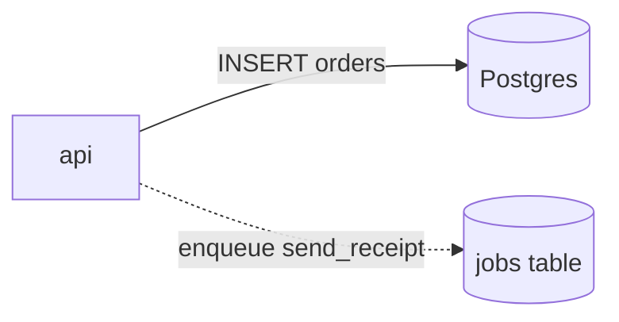

# Architecture sketch

A diagram drawn from folder names and the README looks right and is wrong
in ways a reader cannot see: a box for something the code never calls, an
arrow pointing the wrong way. Tying every element to a line of code makes
the drawing checkable.

## Process

1. **Fix the scope.** Architecture: the whole repository, components and
   what connects them. Sequence: one flow, named by its trigger ("POST
   /orders", "nightly job"). If the user did not say, draw architecture.

2. **Find entry points in code and config**: manifest scripts, `main`
   files, route registrations, CLI commands, queue consumers, scheduled
   jobs, container and deploy files. README, docs, comments and existing
   diagrams are claims to check, not evidence.

3. **Trace outward from each entry point** through imports and calls. At
   every place the code reaches outside its own process (database, cache,
   queue, HTTP API, mail, file storage), note the call site.

4. **Fill the evidence table before drawing.**
   Nodes: name, kind (service, worker, job, store, external), `path:line`.
   Arrows: from, to, what is sent, sync or async, `path:line` of the call.

5. **Draw only what is in the table**, in Mermaid (`flowchart LR` or
   `sequenceDiagram`) unless the user asks for another format. Keep to 5-12
   nodes: merge files into components by deploy unit or top-level
   directory, never by guessed "layers".

6. **Verify.** Re-open every cited line and confirm that the thing exists,
   that the arrow runs from caller to callee, and that async is marked.
   For a sequence, confirm the order matches execution order and that each
   error branch the code handles appears as `alt` or `opt`. Then search
   once for what the drawing may have missed: client constructors, URLs,
   connection strings, environment variables read. Fix the table and the
   diagram together.

7. **Deliver** the diagram, the evidence table and the three lists below.

## Output

````markdown
## <Repository>: architecture | sequence of <trigger>
Read at: <commit hash, or "uncommitted working tree">



| Element | Evidence |
|---|---|
| api | `app/main.py:12` |
| api -> Postgres: INSERT orders | `app/orders.py:41` |

**Not shown:** <components left out on purpose, and why>
**Claimed but not found in code:** <item> (claimed in `README.md:8`)
**Could not verify:** <what you could not read or resolve>
````

## Rules

- **No evidence, no box.** Something named only in a README, doc, comment,
  example config or unused dependency is not drawn. It goes under "Claimed
  but not found in code".
- **Code no entry point imports is not drawn.** "Not shown" lists it as unused.
- **Arrows run from the side that initiates.** An inbound webhook points
  from the external system to the handler; a worker that polls a queue
  points from the worker to the queue. Never draw one system twice to
  separate its inbound and outbound calls.
- **Solid when the caller waits for the reply, including a worker's poll;
  dashed (`-.->`, `-)`) for an enqueue, a schedule or fire-and-forget.**
- **Every arrow has a label saying what moves**: "POST /charges", "enqueue
  send_receipt", "SELECT orders". Not "uses" or "calls".
- **Use the code's names.** No renaming `billing_worker` to "Payment
  Service"; an external system is named by the host or client in the code.
- **Read-only.** Do not run, install or modify the project. Write a file
  only when the user asked for the diagram in one, and touch only that file.
- **Partial reads are labeled**: "partial" in the title, plus the directories read.
- **Updating an existing diagram:** build the table from the code first,
  then compare, and report each removal and addition with its evidence.
- **Nothing outside the Output template** except a legend note of at most
  two sentences and, if you wrote a file, one line naming it: no walkthrough
  or advice unless asked. "Could not verify" holds at most 3 items, each
  naming the box or arrow it could change.
- **An empty list says "none".** Never call the diagram complete or verified.
